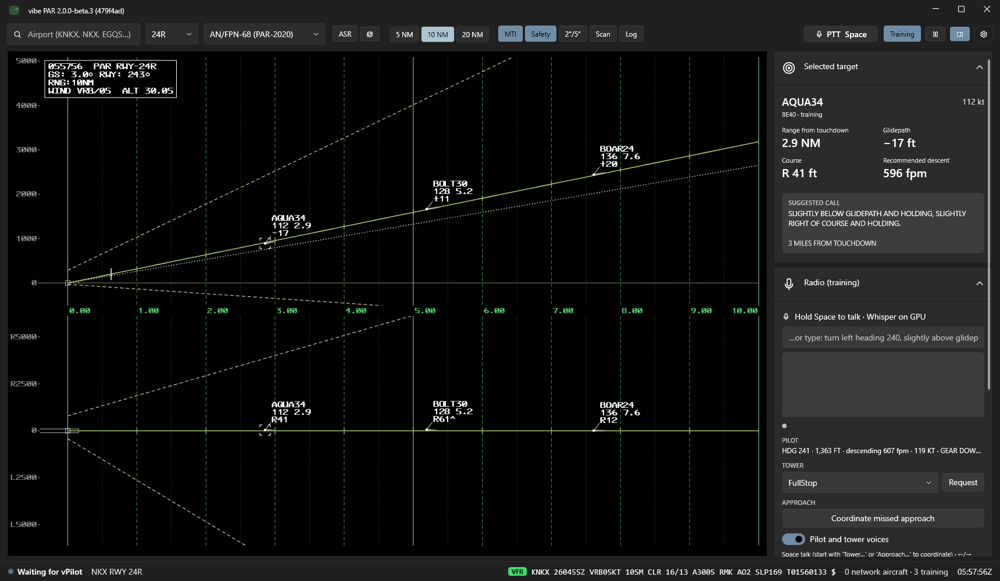

# vibe PAR

*Formerly VATSIM PAR Scope. Yes, it is vibe coded.*

**A Precision Approach Radar scope for VATSIM controllers**, modeled on the US military GCA systems
it imitates: AN/FPN-68, FPN-63, GPN-22, FPN-67, MPN-25 and TPN-31 ATNAVICS. It runs next to CRC and
takes live traffic from it (vNAS's 1 Hz target data, no second connection), or from a vPilot or xPilot
tower view where there is no CRC. It also has a training mode where you talk simulated arrivals down by voice, with pilot, tower and
approach on the other end.

Public information on these radars is scarce, so much of it is a best guess (see
[How accurate is it?](#how-accurate-is-it)).



**[Download the latest release](https://github.com/yanjz124/VATSIM-PAR-Scope/releases)** — Windows 10/11.

## Features

**The scope**
* Elevation and azimuth on one range axis, with glidepath, lower safe limit, decision height and
  lateral safe limits; linear or log range, as on the real indicators.
* Seven radar models, each with its own coverage, scan rate, accuracy and display: from the analog
  FPN-63 B-scope to the FPN-68's color tracks and data blocks and the ATNAVICS expeditionary screen.
* Targets are painted when the simulated beam crosses them, with MTI; real antenna siting off the
  runway; per-runway glidepath, TCH and DH from the approach plate.
* ASR surveillance picture as a flip view or a separate window, with the PAR coverage cone, extended
  centerline and, where the real display had one, a compass rose.
* Live METAR, wind and altimeter on the scope.

**Live VATSIM traffic**
* **CRC feed:** the 1 Hz target data vNAS already sends your CRC, read from your own PC. Tower Cab gives
  exact altitude, STARS gives Mode C. No second connection.
* **vPilot plugin** (MSFS), for fields without CRC: every aircraft vPilot sees, including Velocity fast
  positions at up to 5 Hz, over a tower-view connection.
* **xPilot** (X-Plane), likewise for fields without CRC: vibe PAR listens as an xPilot "visual machine",
  so an xPilot tower view feeds it at up to 5 Hz with no plugin. See [docs/XPILOT.md](docs/XPILOT.md).
* The public data feed is a 15-second fallback.
* Run any of them together: vibe PAR uses whichever is delivering each aircraft, in the order you choose.
* Tracks coast with a CST indicator when an aircraft stops reporting, leaves the radar's coverage, or the
  whole feed drops, and the scope says which.

**Training**
* Arrivals handed off by approach 12–15 NM out; you accept with "radar contact", run the approach and
  coordinate with tower and approach on the same push-to-talk, in your own words.
* Pilots read back, fly your headings and glidepath calls, drift on harder difficulties, fly in the
  live METAR wind, and at decision height land or go around (and tell you why) like real pilots.
* Speech recognition runs locally (Whisper on your graphics card or CPU, or Windows Speech). Pilot,
  tower and approach talk back in natural neural voices (Kokoro or Piper, run on your PC) or the
  Windows voices, each pilot with their own voice, through a radio effect. Tower and approach call on
  the landline: an override tone, then a telephone-line voice, which your push-to-talk does not block.
* Every call and coordination has a hotkey and a button, so you can run a session without talking or
  typing. Keys can be changed.
* Or watch: an **AI final controller** can work the arrivals in its own voice, from the handoff to
  the landing or missed approach, coordination included. Turn it off at any point to take over.
* Every session is logged so you can review the talk-down afterwards.

With **Training** off it is a plain scope: no suggested calls and nothing simulated.

## Install

1. Download `PARScope-Setup-<version>.exe` from the [releases](https://github.com/yanjz124/VATSIM-PAR-Scope/releases)
   page and run it. It installs for your user only (no admin) and lets you choose the folder. Options:
   * **vPilot plugin:** finds vPilot's `Plugins` folder and installs it there (close vPilot first). Only
     needed if you take traffic from vPilot; CRC and xPilot users can leave it unticked.
   * **Npcap:** downloads Npcap from npcap.com and runs its installer, so the CRC feed works without
     administrator rights.

   **xPilot users** need nothing extra: after installing, follow [docs/XPILOT.md](docs/XPILOT.md).
2. Start vibe PAR. The first start downloads the airport database (FAA NASR and OurAirports). Type an
   airport (`KNKX`, `NKX`, `EGQS`…) and pick the runway.

Prefer not to install? The zip on the same page has `PARScope.exe` (keep the `runtimes` folder next to
it) and the plugin in `Plugin\`, which you copy into `%LOCALAPPDATA%\vPilot\Plugins\` yourself.

**Updates**: vibe PAR checks for a new release at start-up and offers to install it (or check any time with **Check for updates now** in **Settings › Data**). With the
installer, the update includes the plugin; with the zip, copy a changed plugin by hand. The title bar
shows the version and the commit it was built from.

## Getting live traffic

### With CRC (recommended)

vNAS sends CRC its display targets over UDP about once a second, as plain MessagePack. vibe PAR reads them
on your own PC by packet capture. It is read-only: nothing is sent, and CRC and the network are untouched.

1. **Settings › Data › CRC feed** is on **Auto** by default: Npcap if it is installed, otherwise the raw
   socket when vibe PAR runs as administrator. To pick one yourself:
   * **Raw socket:** nothing to install, but vibe PAR must run as administrator. The settings page offers a
     restart.
   * **Npcap:** install [Npcap](https://npcap.com) once, then vibe PAR runs normally.
2. Connect to your position in CRC and open a **Tower Cab** window at the PAR's field. That gives exact
   altitude for aircraft out to 70 NM or so, and it is what the PAR uses. STARS data (Mode C in 100 ft
   steps) only feeds the ASR, because on the elevation scope it would draw a staircase. While aircraft
   near the field are known only from STARS, the PAR shows a **STARS DATA ONLY** warning.
3. The status bar shows **CRC (vNAS) · 1 Hz**.

This is unofficial and may stop working with a vNAS update. The format is documented in
[docs/CRC-VNAS-UDP.md](docs/CRC-VNAS-UDP.md).

### With vPilot (fields without CRC)

Where your facility is not on CRC (EuroScope areas, for example), use vPilot's **tower view** with the
plugin. The VATSIM Code of Conduct (C7(b)) allows a controller one extra tower-view connection,
`(CID)_TV`.

1. Connect to your position in your ATC client.
2. Start vPilot with the plugin installed and type `.towerview`.
3. The status bar shows what is arriving:
   * **5 Hz data**: Velocity fast positions.
   * **5 s updates only**: normal updates only.

### With xPilot (X-Plane)

xPilot can copy its traffic to "visual machines" (extra X-Plane PCs), and vibe PAR listens as one on
`127.0.0.1:53100`. As with vPilot, the simulator has to be running. **Step-by-step guide with
troubleshooting: [docs/XPILOT.md](docs/XPILOT.md).**

1. In xPilot, type `.visualip 127.0.0.1` once, then restart xPilot. The command replaces the whole list,
   so if you already have visual PCs, list them all: `.visualip 192.168.1.20 127.0.0.1`.
2. Start X-Plane with a flight loaded, then type `.towerview` in xPilot.
3. The status bar shows **xPilot tower view · 5 Hz data**. xPilot only passes on positions from Velocity
   fast updates, which VATSIM sends for aircraft near you.

The listener is on by default (**Settings › Data › Receive traffic from xPilot**) and only accepts
connections from this PC. It reads; it sends nothing to xPilot beyond the connection handshake.

With none of these, the **VATSIM data feed (15 s)** can be turned on in **Settings › Data**: fine for watching
traffic, too slow for precision guidance.

### Several sources at once

All sources can run together, and vibe PAR uses whichever is delivering each aircraft. When more than one
is, **Settings › Data › Source priority** decides (CRC › vPilot/xPilot › data feed by default, or any
other order). If the chosen source stops for an aircraft, the next one takes over by itself. CRC STARS-only
data, with its 100 ft altitude steps, always ranks below an exact source.

### When data stops

A track that stops being painted **coasts**: it moves on at its last measured rates, one step per scan,
with a hollow symbol and **CST** in its data block (on the ASR, a **#** with CST). The side panel says why, and the track is dropped after a time that depends
on the reason:

| Reason | Dropped after |
|---|---|
| Out of coverage: still reporting, but outside the radar's range, sector or elevation | 6 s |
| Signal lost: this aircraft's reports stopped (no phantom returns are painted) | 12 s |
| Data lost: the whole feed went silent (**DATA LOST** on the status bar and across the PAR) | 30 s |
| STARS only: the aircraft fell back to 100 ft Mode C (not used on the PAR) | 6 s |

No suggested calls are made from a coasting track. Hover the status text for details; **Settings ›
Diagnostics** shows live rates per aircraft.

## Using the scope

| Control | |
|---|---|
| Airport, runway, radar model | Toolbar, left. Each model sets its own Log, Scan and compass-rose defaults; override them freely. |
| **ASR**, pop-out | Flip the scope to the ASR (**Z**), or put the ASR in its own window. |
| Range 5/10/20 NM | **PgUp / PgDn**. |
| **MTI**, **Safety**, **2°/5°**, **Scan**, **Log** | Moving target indicator, safe limits, UK 2°/5° azimuth lines, antenna sweep, compressed range. |
| Text and symbol size | **Settings › Display**, 80–200 %, for both scopes. |
| Target | Click, or **Tab** / **Esc**. The side panel shows range, glidepath and course deviation. |
| Gear button | **Settings**: per-runway PAR siting, display, data sources, training aids, audio, diagnostics. |

Radar noise, multipath and clutter are off unless you turn on **Settings › Display › Simulate radar
errors**; targets otherwise plot exactly where the aircraft is, once per scan.

## Training mode

Turn on **Training**, pick a **difficulty** and press **Spawn arrival**.

| Difficulty | |
|---|---|
| Easy | Light wind, precise pilots, close to the centerline. |
| Normal | Moderate wind, average pilots. |
| Hard | Pilots drift off heading and descent rate until corrected; the wind shifts on descent. |
| Expert | Gusts and shear, sloppy and slow pilots, steady drift. |

Arrivals fly in the live METAR wind (**Settings › Training** for a random one). Callsigns and types are
realistic (Navy, Marine, Reach, squadron callsigns from the
[Military Callsign List](https://henney.com/chm/callsign.htm)); approach speeds come from the FAA
Aircraft Characteristics Database. Generated callsigns are always military, at most 5 characters on the
radar (6 in **Settings › Training**; long callwords are shortened to a form that still reads as the word,
BANSHEE21 → BNSH21, but are still spoken in full), and never a civil operator's designator. You can set your own callsign and ICAO type; a typed
callsign with an ICAO three-letter designator is spoken with its telephony from FAA JO 7340.2 and the
flight number in group form ("RPA4567": "Brickyard forty-five sixty-seven").

### Talking

Hold **push-to-talk** (**Space** by default, any key in **Settings › Audio**, or hold the **PTT**
button in the toolbar, which turns red while you transmit) and speak. You can also type. Standard
7110.65 phraseology works, and so do common variations ("well above glide and holding", "initiate
descent").

* Pilots read back until "do not acknowledge further transmissions", then only answer a radio check or
  a missed approach.
* Headings: "turn left heading 050", or a relative turn, "turn two degrees left" / "turn right ten
  degrees", from the heading last assigned.
* Glidepath calls change the descent rate, starting from what the pilot is already flying: "…and
  holding" makes them correct more, "going above/below" firmly, "…coming down/up" keeps a correction
  that is working, "…rapidly" eases off, "on glidepath" returns to the normal rate. Course calls are
  information only (the pilot just stops drifting off the assigned heading), so correct with headings.
* "In the event of missed approach, climb and maintain two thousand, turn left heading one eight zero"
  is read back and remembered; "execute missed approach" makes them fly it.
* At **decision height** the pilot continues only with the runway in sight (live ceiling and visibility),
  a landing clearance, gear down and a stable approach. Otherwise they go around and say why, e.g.
  "Going around, no landing clearance". If they continue, they fly the rest visually, lining up with the
  runway and following the glidepath to touchdown. Touch and go, low approach and option clearances are flown.

### Results and grades

When an approach ends, the radio log shows the result in green: where it touched down (feet past the
threshold, left or right of the centerline, sink rate), a touch and go, a low approach, a go-around and why,
or ground contact short of the runway. A talk-down you directed is then graded out of 100:

| | |
|---|---|
| Precision (40) | Share of the final on glidepath and on course, with the scope's deviation bands |
| Transmissions (30) | Longest silence on final (5 seconds or less), range information each mile |
| Procedures (20) | Missed approach and lost communications instructions before descent, wheels check, landing clearance relayed by 2 miles |
| Outcome (10) | Landed in the touchdown zone; a go-around the controller should have prevented scores 0 (weather does not count against you) |

A 90+, B 80+, C 70+, D 60+; ground contact is an F. The grade lists what cost points, and the session log
keeps it. Transmissions that were not understood are flagged in orange at the start of the line.

### Coordination

Start a call with **Local** (or **Tower**), **Approach** or **Departure** and it goes to that controller
instead of the pilot. Wording can be loose; the aircraft is found by its callsign or number.

* **Where**: on final by default; in the Training traffic panel, approach can also hand arrivals over on a
  dogleg (1.5–3 NM off the centerline, 30–45° toward it) or a base leg (3–5 NM abeam, heading for the
  centerline) for you to turn onto final.
* **Handoff in**: approach calls "handoff, one four mile final, Navy one two three four, two thousand
  five hundred, heading two four zero". Accept with "Navy one two three four, radar contact" and your
  initials. Approach answers with theirs and switches the pilot, who checks in. Unanswered handoffs are
  repeated every 20 seconds.
* **Tower**: request a clearance (full stop, touch and go, low approach, option) and relay it.
* **Missed approach**: hand the aircraft back to approach, then tell the pilot "contact approach".
  Aircraft that go missed, or fly a touch and go or low approach, are vectored round approach's radar
  pattern (upwind, crosswind, downwind about 2½ NM abeam, base) and handed off to you again 11–13 NM out
  for another approach a few minutes later. They stay on the ASR the whole way. Full-stop
  landings end there. Turn this off in the Training traffic panel.

### Watching the AI work final

Turn on **AI works final** in the Training traffic panel and spawn arrivals. An AI final controller, in
its own voice (**Settings › Audio › AI final voice**), runs the position the way you would:

* accepts approach's handoff on the landline ("radar contact"), and after the pilot checks in gives the
  approach brief (missed approach and lost communications instructions);
* vectors arrivals handed over on a base leg or dogleg onto final, then gives the course and glidepath
  calls the scope shows, with its own headings, about every five seconds: "approaching glidepath, wheels
  should be down", "begin descent", "do not acknowledge further transmissions", a range call each mile,
  decision altitude, approach lights and threshold;
* asks local for the clearance about 6 miles out and relays it, then "contact tower after landing";
* after a missed approach, hands the aircraft back to approach and switches the pilot.

The pilots are talked down (not self-flying), so the AI's calls really fly the aircraft. Like a real
talk-down, the odd approach ends in a go-around. Its calls go through the same log, pilot model and
grade as yours. Turn it off at any point to take over the position.

### Keys

Every call has a key, sent to the selected aircraft (or the only one) as if you had said it. The
defaults are laid out like a game: left hand on WASD, the number row for the approach in the order it
is flown. **F1** (or **Key assignments** in the training panel or **Settings › Audio**) lists them all;
click one to change it.

| | |
|---|---|
| Space | Push to talk |
| F (or Enter) | Send the suggested call, with the right magnitude and trend |
| W / S (or ↑ / ↓) | Above / below glidepath |
| A / D | Left / right of course |
| X / C | On glidepath / on course |
| hold Ctrl / Shift / Alt | "slightly…" / "well…" / "going…" on the six keys above |
| Q / E (or ← / →) | Turn left / right 1° (Shift: 5°) |
| Ctrl+Q / Ctrl+E, B | No-gyro: turn left / right (until told to stop), stop turn. "Make half standard rate turns" is understood by voice |
| R, G, H | Range from touchdown, wheels should be down, how do you hear me |
| 1 | Approach: radar contact on a handoff; after a missed approach, coordinate it, then "contact approach" |
| 2 | Approach brief: PAR to the runway, missed approach and lost communications instructions in one call |
| 3, 4 | Begin descent, do not acknowledge further transmissions |
| 5 (or T) | Tower: request the clearance from local, then relay it to the pilot |
| 6 | Contact tower after landing |
| M, Shift+M | Execute missed approach; if runway not in sight, execute missed approach |
| V, Shift+V | Level off, resume normal rate of descent |
| Tab, Esc, PgUp / PgDn | Next target, deselect, range scale |
| Z, P, F1 | Flip PAR / ASR, pause, key assignments |

### Voices

Chosen in **Settings › Audio**:

* **Kokoro** (downloaded on first use, 330 MB): the most natural; about half real time on a CPU, and
  each reply is synthesized while the pilot "thinks", so there is no extra wait.
* **Piper LibriTTS-R** (78 MB): very quick, with hundreds of speakers for variety.
* **Windows voices**: built in, robotic.

Each pilot gets their own voice (picked from the callsign) unless you turn that off, and the radio
effect band-limits the audio and adds the squelch.

### Speech recognition

Chosen in **Settings › Audio**, together with the microphone and output device.

* **Whisper** (tiny, base or small; downloaded on first use, 75–470 MB): understands accents and loose
  wording, needed for interphone calls. It transcribes each phrase while you are still talking, so the
  result is ready a fraction of a second after you let go. It uses your graphics card (any
  Vulkan-capable NVIDIA, AMD or Intel GPU) and falls back to the CPU; on a CPU, tiny.en is the quick
  choice and small.en the accurate one.
* **Windows Speech**: offline and instant, but only standard phraseology.

### Session log

Each session is written to `%AppData%\VATSIM-PAR-Scope\diagnostics\training-*.log`: what you said, how
it was understood, what the pilots did and why they went around, and every 2 seconds each aircraft's
position against the glidepath and course with the call the scope would have made.

## How the 5 Hz data works

vPilot's plugin API only raises an update every ~5 seconds, although vPilot receives Velocity fast
positions at up to 5 Hz. The plugin reads those from vPilot's internal event bus. It is read-only and
never sends anything to the network; if a vPilot update breaks it, it falls back to the 5-second
updates. VATSIM only sends fast positions to clients close enough to want them, so run
`TrafficProbe.exe` (with the scope closed) to see what you actually get. Details:
[docs/VELOCITY.md](docs/VELOCITY.md).

## How accurate is it?

Honestly: less than it looks. Very little about these radars is public. There are no operator
manuals for most of the displays, only a few photos and videos, and almost nothing on internals like
scan rates or beam widths. So:

* **Procedures and phraseology** (7110.65, TERPS, minimums) come from published documents and are the
  most reliable part.
* **What each display looks like** is an artistic reconstruction from a handful of photos and videos:
  colors, symbols, fonts and layout are best guesses.
* **Radar behavior** (scan rates, beam widths, coverage, target size, pilot reactions) is partly
  sourced and partly plausible numbers filled in to make it work. Some of those numbers and details
  were suggested by the AI that wrote most of this code, and some may simply be wrong.

Treat it as a training toy and a fun scope for VATSIM, not a reference for the real equipment. If you
know how the real thing works, corrections are very welcome.
[docs/PAR-RESEARCH.md](docs/PAR-RESEARCH.md) marks what is sourced and what is unverified.

## Sources

FAA JO 7110.65, FAA Order 8260.3 (TERPS), ICAO Annex 10, NAVAIR 00-80T-112/114, NAVEDTRA 14342A,
AFMAN 13-204v3 and 11-217, UK MAA RA 3291, the MCAS Cherry Point facility manual, and footage of
in-service displays. [docs/PAR-RESEARCH.md](docs/PAR-RESEARCH.md) lists what came from where.

## Development

Requires the .NET 10 SDK and vPilot (the plugin compiles against vPilot's assemblies; set `VPILOT_DIR`
if it is not in `%LOCALAPPDATA%\vPilot`). The installer needs Inno Setup 6
(`winget install JRSoftware.InnoSetup`).

```powershell
dotnet build VATSIM-PAR-Scope.sln
dotnet test tests\PARScope.Core.Tests
.\scripts\build-release.ps1 -Version 2.0.0-beta.3            # zip and installer in .\release
.\scripts\publish-release.ps1 -Version 2.0.0-beta.3          # tag, GitHub release, prune old releases
```

| Project | |
|---|---|
| `src/PARScope.Core` | Geodesy, traffic protocol and tracking, PAR geometry, radar and ASR models, phraseology, airport data, METAR, training simulation. No UI; unit tested. |
| `src/PARScope.App` | The scope: WPF on .NET 10 with [WPF UI](https://github.com/lepoco/wpfui), SkiaSharp, NAudio, Whisper.net and sherpa-onnx. |
| `src/RadarStreamerPlugin` | vPilot plugin (.NET Framework 4.7.2). |
| `tools/TrafficProbe` | Update-rate diagnostic. |
| `installer/` | Inno Setup script. |

The plugin and scope talk NDJSON over UDP port 49090 (protocol v2, documented in `Plugin.cs`). xPilot
connects as to a visual machine: nng pair1 over TCP port 53100, MessagePack messages
(`XPilotVisualSource.cs`). The CRC feed is described in [docs/CRC-VNAS-UDP.md](docs/CRC-VNAS-UDP.md).

## License

MIT. Voices: [Kokoro-82M](https://huggingface.co/hexgrad/Kokoro-82M) (Apache-2.0); Piper
[LibriTTS-R](https://www.openslr.org/141/) voice (trained on LibriTTS-R by Koizumi et al., CC BY 4.0),
both run with [sherpa-onnx](https://github.com/k2-fsa/sherpa-onnx) (Apache-2.0).
